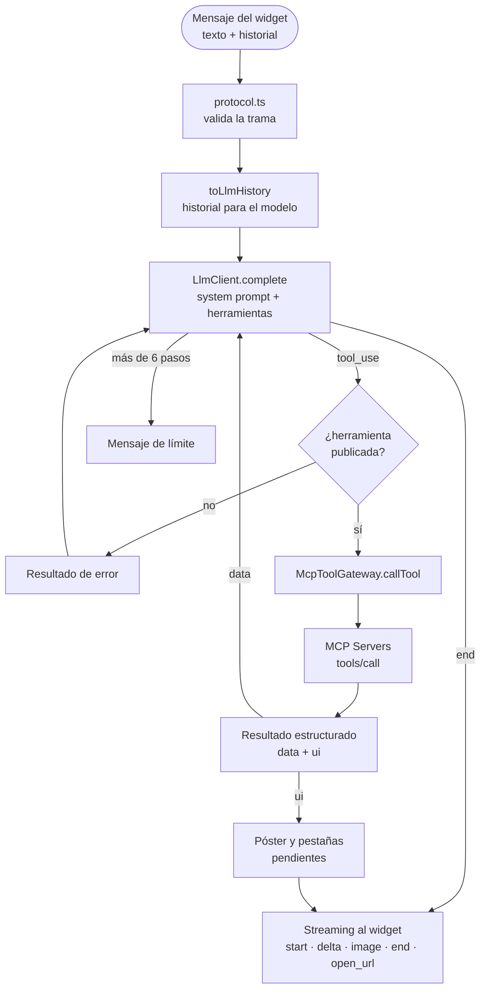

# Arquitectura del agente (Fase 2)

Este documento cubre el agente que recomienda películas: cómo está organizado, cómo descubre sus herramientas por MCP y qué le envía al widget. La arquitectura del widget (Fase 1) sigue en [ARQUITECTURA.md](ARQUITECTURA.md); el paso a la Fase 2 no tocó su diseño, solo le agregó dos eventos.

## Diagrama de bajo nivel de los agentes

### Clasificación

El sistema es **un solo agente, centralizado**, del tipo _orquestador con herramientas_:

- **Centralizado:** un único orquestador decide en cada paso qué herramienta llamar y es el único que habla con el modelo. Los MCP Servers no toman decisiones ni se comunican entre sí; ejecutan herramientas deterministas.
- **No jerárquico:** no hay sub-agentes con su propio modelo. Se evaluó separar un “agente de películas” y un “agente de libros”, pero comparten casi todo el contexto (la comparación necesita la ficha de la película) y la delegación habría duplicado llamadas al modelo y superficie de inyección sin mejorar las respuestas.
- **Herramientas como servicios:** la especialización vive en los MCP Servers. Si en el futuro se necesitan varios agentes, cualquiera de ellos puede consumir los mismos servidores; la frontera MCP ya está trazada.

### Organización interna de un turno

### Componentes

| Componente             | Archivo                                  | Responsabilidad                                                                                          |
| ---------------------- | ---------------------------------------- | -------------------------------------------------------------------------------------------------------- |
| Servidor del agente    | `agent-server/src/server.ts`             | WebSocket del widget, `/healthz`, límite de tasa, un turno a la vez por conexión, orígenes permitidos    |
| Orquestador            | `agent-server/src/agent.ts`              | Ciclo ReAct, límites por turno y streaming del resultado                                                 |
| System prompt          | `agent-server/src/system-prompt.ts`      | Rol, capacidades y uso de cada herramienta. Sin secretos                                                 |
| Puerto del modelo      | `agent-server/src/ports/llm.ts`          | Contrato `LlmClient`; adaptadores en `llm/anthropic-llm.ts` y `llm/openai-compatible-llm.ts`             |
| Puerto de herramientas | `agent-server/src/ports/tool-gateway.ts` | Contrato `ToolGateway`; adaptador MCP en `tools/mcp-tool-gateway.ts`                                     |
| Base de los MCP        | `mcp-kit/src`                            | Caché, cupo diario, cliente HTTP con errores como valores, servidor HTTP sin estado y arranque por stdio |

### Formato de las respuestas al widget

El contrato del proyecto 1 se extendió con dos eventos, validados en `transport-ws/src/parse-agent-event.ts`:

| Evento            | Campos                           | Qué hace el widget                                                                                |
| ----------------- | -------------------------------- | ------------------------------------------------------------------------------------------------- |
| `message.start`   | `messageId`                      | Crea el mensaje del agente                                                                        |
| `message.delta`   | `messageId`, `text`              | Agrega texto Markdown                                                                             |
| `message.image`   | `messageId`, `url`, `alt`        | Pinta el póster si el servidor está en su lista blanca                                            |
| `message.end`     | `messageId`                      | Cierra el mensaje                                                                                 |
| `action.open_url` | `actionId`, `url`, `title`       | Abre la pestaña si el sitio está en su lista blanca; si el navegador la bloquea, ofrece el enlace |
| `error`           | `code`, `message`, `recoverable` | Muestra el aviso                                                                                  |

La URL de una imagen o de una pestaña **nunca la escribe el modelo**: la arma el MCP Server a partir de un identificador validado, y el widget la revisa contra su lista blanca antes de pintarla o abrirla.

Las pestañas se abren con `window.open` al recibir el evento. Los navegadores solo permiten ventanas emergentes poco después de una acción del usuario; si el modelo tarda, el navegador puede bloquearla. En ese caso el widget lo detecta y muestra el enlace. Para la demo conviene permitir ventanas emergentes en el sitio.

## Cómo escalar el agente

| Necesidad                                 | Dónde va                                                                                                           |
| ----------------------------------------- | ------------------------------------------------------------------------------------------------------------------ |
| Nuevo MCP Server (por ejemplo, streaming) | `packages/mcp-<nombre>` sobre `mcp-kit`, servicio nuevo en `docker-compose.yml` y entrada en `MCP_SERVERS`         |
| Nuevo proveedor de modelo                 | Adaptador de `LlmClient` en `agent-server/src/llm/` y caso en `create-llm.ts`                                      |
| Nuevo tipo de directiva para el widget    | Variante en `UiDirective`, evento en `AgentEvent`, validación en `parse-agent-event.ts` y componente en `ui-react` |
