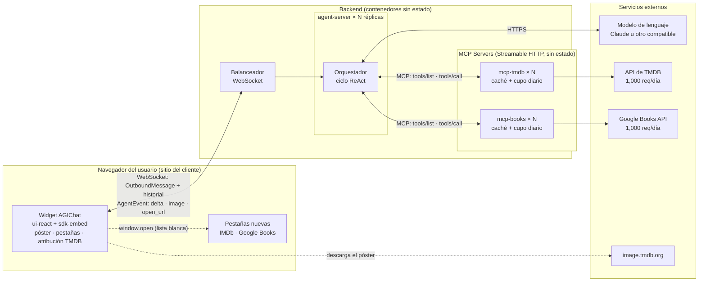

# Arquitectura del agente (Fase 2)

Este documento cubre lo que se agregó en el proyecto 2: el agente que recomienda películas y los MCP Servers que exponen sus herramientas. La arquitectura del widget (Fase 1) sigue en [ARQUITECTURA.md](ARQUITECTURA.md); el paso a la Fase 2 no tocó su diseño, solo le agregó dos eventos.

## Diagrama de alto nivel

### Por qué escala

| Decisión                               | Qué permite                                                                                                                                                                                                                                                                                                                                                                                            |
| -------------------------------------- | ------------------------------------------------------------------------------------------------------------------------------------------------------------------------------------------------------------------------------------------------------------------------------------------------------------------------------------------------------------------------------------------------------ |
| **Backend sin estado**                 | El historial viaja en cada mensaje (`OutboundMessage.history`, los últimos 12 mensajes). Cualquier réplica atiende cualquier turno, no hace falta afinidad de sesión y una réplica que se reinicia no pierde conversaciones. Las réplicas del agente se agregan detrás de un balanceador de WebSocket; los MCP, que no publican puerto, se escalan directo con `docker compose up --scale mcp-tmdb=N`. |
| **MCP Servers desacoplados**           | Cada servidor se despliega, escala y falla por separado. Si Google Books se cae, el agente sigue recomendando películas (`McpToolGateway` sirve las herramientas disponibles y reintenta las demás). Otro agente de AGIChat puede reutilizar las herramientas sin tocar este código.                                                                                                                   |
| **Descubrimiento dinámico**            | El agente no tiene herramientas escritas a mano: las pide con `tools/list` y renueva el catálogo cada 5 minutos. Agregar una herramienta o un servidor nuevo es cambiar `MCP_SERVERS`, sin redesplegar el orquestador.                                                                                                                                                                                 |
| **Caché y cupo en cada MCP**           | Las APIs gratuitas dan 1,000 peticiones diarias. Un caché de 6 horas (con deduplicación de peticiones simultáneas) evita repetir consultas y `DailyBudget` corta antes de agotar el cupo, con un mensaje claro en vez de errores 429. La interfaz `TtlCache` es pequeña a propósito para cambiarla por Redis cuando haya varias réplicas.                                                              |
| **Contenedores**                       | Una sola imagen (`Dockerfile`) con los tres procesos; cada contenedor elige su proceso con `SERVICE`. Toda la configuración entra por variables de entorno. Cada servicio expone `/healthz` para el orquestador de contenedores.                                                                                                                                                                       |
| **Costos acotados por turno**          | Máximo 6 llamadas al modelo y 10 a herramientas por turno, 20 mensajes por minuto por conexión y tramas de 64 KB. Un usuario (o una inyección) no puede disparar un bucle que agote el cupo de todos.                                                                                                                                                                                                  |
| **Proveedor de modelo intercambiable** | El orquestador depende del puerto `LlmClient`. Hay dos adaptadores: Claude (SDK oficial) y cualquier API “chat completions” con plan gratuito. Cambiar de proveedor es una variable de entorno.                                                                                                                                                                                                        |

Límites conocidos: el caché vive en memoria de cada réplica de MCP (con N réplicas, el consumo del cupo crece hasta N veces en el peor caso); el límite de tasa es por conexión y no por usuario. Ambos se resuelven con un almacén compartido (Redis) sin cambiar interfaces.

## Diagrama de bajo nivel de los agentes

### Clasificación

El sistema es **un solo agente, centralizado**, del tipo _orquestador con herramientas_:

- **Centralizado:** un único orquestador decide en cada paso qué herramienta llamar y es el único que habla con el modelo. Los MCP Servers no toman decisiones ni se comunican entre sí; ejecutan herramientas deterministas.
- **No jerárquico:** no hay sub-agentes con su propio modelo. Se evaluó separar un “agente de películas” y un “agente de libros”, pero comparten casi todo el contexto (la comparación necesita la ficha de la película) y la delegación habría duplicado llamadas al modelo y superficie de inyección sin mejorar las respuestas.
- **Herramientas como servicios:** la especialización vive en los MCP Servers. Si en el futuro se necesitan varios agentes, cualquiera de ellos puede consumir los mismos servidores; la frontera MCP ya está trazada.

### Organización interna de un turno

### Componentes

| Componente             | Archivo                                                   | Responsabilidad                                                                                          |
| ---------------------- | --------------------------------------------------------- | -------------------------------------------------------------------------------------------------------- |
| Servidor del agente    | `agent-server/src/server.ts`                              | WebSocket del widget, `/healthz`, límite de tasa, un turno a la vez por conexión, orígenes permitidos    |
| Orquestador            | `agent-server/src/agent.ts`                               | Ciclo ReAct, límites por turno y streaming del resultado                                                 |
| System prompt          | `agent-server/src/system-prompt.ts`                       | Rol, capacidades y uso de cada herramienta. Sin secretos                                                 |
| Puerto del modelo      | `agent-server/src/ports/llm.ts`                           | Contrato `LlmClient`; adaptadores en `llm/anthropic-llm.ts` y `llm/openai-compatible-llm.ts`             |
| Puerto de herramientas | `agent-server/src/ports/tool-gateway.ts`                  | Contrato `ToolGateway`; adaptador MCP en `tools/mcp-tool-gateway.ts`                                     |
| MCP de TMDB            | `mcp-tmdb/src/tools.ts`                                   | 6 herramientas; arma las URL del póster y de IMDb a partir de identificadores validados                  |
| MCP de libros          | `mcp-books/src/tools.ts`, `book-matcher.ts`, `compare.ts` | 4 herramientas; elige la obra original (descarta guiones y guías) y calcula el veredicto                 |
| Base de los MCP        | `mcp-kit/src`                                             | Caché, cupo diario, cliente HTTP con errores como valores, servidor HTTP sin estado y arranque por stdio |

### Herramientas MCP

| Servidor    | Herramienta                | Qué devuelve                                                                                                        |
| ----------- | -------------------------- | ------------------------------------------------------------------------------------------------------------------- |
| `mcp-tmdb`  | `tmdb_search_movies`       | Hasta 6 películas por título                                                                                        |
|             | `tmdb_discover_movies`     | Recomendaciones por género, año, calificación mínima y orden                                                        |
|             | `tmdb_similar_movies`      | Películas parecidas a una dada                                                                                      |
|             | `tmdb_movie_details`       | Ficha con géneros, duración, ID de IMDb y `basedOnBook` (endpoint `external_ids` y `keywords` en una sola petición) |
|             | `tmdb_show_poster`         | Directiva `image` con la URL de `image.tmdb.org`                                                                    |
|             | `tmdb_open_imdb`           | Directiva `open_url` hacia `www.imdb.com`                                                                           |
| `mcp-books` | `books_find_for_movie`     | La novela original o `found: false` si la película no tiene libro                                                   |
|             | `books_details`            | Ficha del libro con calificación y número de calificaciones                                                         |
|             | `books_compare_with_movie` | Veredicto, si vale la pena verla y nivel de confianza                                                               |
|             | `books_open_google_books`  | Directiva `open_url` hacia `books.google.com`                                                                       |

### Formato de las respuestas al widget

El contrato del proyecto 1 se extendió con dos eventos, validados en `transport-ws/src/parse-agent-event.ts`:

| Evento            | Campos                           | Qué hace el widget                                                                                |
| ----------------- | -------------------------------- | ------------------------------------------------------------------------------------------------- |
| `message.start`   | `messageId`                      | Crea el mensaje del agente                                                                        |
| `message.delta`   | `messageId`, `text`              | Agrega texto Markdown                                                                             |
| `message.image`   | `messageId`, `url`, `alt`        | Pinta el póster si el servidor está en su lista blanca                                            |
| `message.end`     | `messageId`                      | Cierra el mensaje                                                                                 |
| `action.open_url` | `actionId`, `url`, `title`       | Abre la pestaña si el sitio está en su lista blanca; si el navegador la bloquea, ofrece el enlace |
| `error`           | `code`, `message`, `recoverable` | Muestra el aviso                                                                                  |

La URL de una imagen o de una pestaña **nunca la escribe el modelo**: la arma el MCP Server a partir de un identificador validado, y el widget la revisa contra su lista blanca antes de pintarla o abrirla.

Las pestañas se abren con `window.open` al recibir el evento. Los navegadores solo permiten ventanas emergentes poco después de una acción del usuario; si el modelo tarda, el navegador puede bloquearla. En ese caso el widget lo detecta y muestra el enlace. Para la demo conviene permitir ventanas emergentes en el sitio.

## Cómo escalar el agente

| Necesidad                                 | Dónde va                                                                                                           |
| ----------------------------------------- | ------------------------------------------------------------------------------------------------------------------ |
| Nueva herramienta de películas o libros   | `defineTool` en `mcp-tmdb/src/tools.ts` o `mcp-books/src/tools.ts`, con su prueba. El agente la descubre solo      |
| Nuevo MCP Server (por ejemplo, streaming) | `packages/mcp-<nombre>` sobre `mcp-kit`, servicio nuevo en `docker-compose.yml` y entrada en `MCP_SERVERS`         |
| Nuevo proveedor de modelo                 | Adaptador de `LlmClient` en `agent-server/src/llm/` y caso en `create-llm.ts`                                      |
| Nuevo tipo de directiva para el widget    | Variante en `UiDirective`, evento en `AgentEvent`, validación en `parse-agent-event.ts` y componente en `ui-react` |
| Varias réplicas compartiendo caché        | Implementación de `TtlCache` sobre Redis inyectada en `ApiClient`                                                  |
