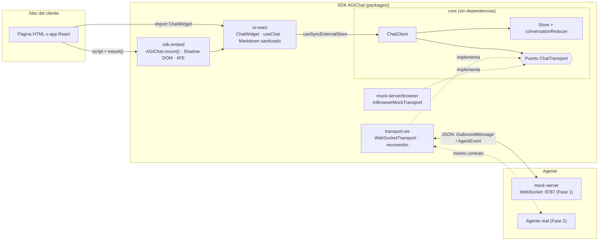

# Arquitectura de AGIChat SDK

## Contexto

AGIChat entrega un widget de chat agéntico que cualquier cliente incrusta en su propio sitio. El proyecto tiene dos fases:

- **Fase 1 (este repositorio):** la interfaz completa, conectada a un agente simulado que responde en Markdown y con streaming token por token.
- **Fase 2:** el mismo widget, conectado al agente real.

El requisito que más pesa en el diseño es que el paso a la Fase 2 **no obligue a rehacer la interfaz**. También pesan otros tres: el widget vive en sitios de terceros (aislamiento de estilos y seguridad del contenido), se distribuye como SDK (para equipos con React y sin React) y debe probarse con una cobertura de 80 % o más.

## Diagrama de alto nivel



Las flechas sólidas indican dependencia en tiempo de ejecución. Las punteadas con «implementa» señalan los adaptadores del puerto. `InBrowserMockTransport` ejecuta en la página la misma lógica de `mock-server` y permite publicar la demo en GitHub Pages, donde no existe servidor WebSocket.

## Por qué puertos y adaptadores

El núcleo (`core`) define **qué** necesita de un agente: el puerto `ChatTransport` en `packages/core/src/ports/transport.ts`. Cada canal concreto es un adaptador que lo implementa. La interfaz solo conoce el puerto.

| Opción                              | Ventaja                                                                                          | Por qué no se eligió                                                                                                                         |
| ----------------------------------- | ------------------------------------------------------------------------------------------------ | -------------------------------------------------------------------------------------------------------------------------------------------- |
| **Puertos y adaptadores (elegida)** | Cambiar mock por agente real equivale a inyectar otro objeto; el núcleo se prueba sin red ni DOM | Más paquetes y más indirección que un widget simple                                                                                          |
| MVC dentro de React                 | Menos archivos; el estado vive en componentes                                                    | La lógica de streaming, errores y reconexión quedaría atada a React. Probarla exigiría renderizar, y la Fase 2 obligaría a tocar componentes |
| Widget monolítico                   | Lo más rápido de escribir                                                                        | El WebSocket del mock quedaría dentro de la interfaz: justo lo que el enunciado pide evitar                                                  |

Esta separación tiene un costo: más paquetes, alias de resolución en Vitest y Vite, y reglas de ESLint que mantener. A cambio:

- **La Fase 2 se reduce a un adaptador.** Basta con `new WebSocketTransport({ url: '<agente real>' })` si el agente respeta el contrato, o con un paquete `transport-<nombre>` nuevo si usa otro protocolo.
- **Los límites no dependen de la disciplina.** `eslint.config.mjs` convierte en error de CI que `ui-react` importe un transporte o que `core` importe React o `ws`.
- **La lógica difícil es pura.** El reductor, el cliente y el protocolo del mock se prueban en milisegundos.

Otras decisiones clave, con su contexto y sus consecuencias, están en [docs/adr](adr/).

## Flujo de un mensaje

1. `Composer` llama a `useChat().sendMessage(texto)`.
2. `ChatClient` valida (texto vacío, agente ocupado, canal cerrado), despacha `user/submit` para pintar el mensaje de inmediato y llama a `transport.send()`.
3. El adaptador envía `{ conversationId, messageId, text }`.
4. El agente responde con eventos `message.start`, `message.delta` (n veces) y `message.end`, o con `error`.
5. `ChatClient` traduce cada evento a una acción del reductor; `useSyncExternalStore` repinta.
6. `MarkdownMessage` renderiza el texto acumulado con `react-markdown`, `remark-gfm` y `rehype-sanitize`.

La conexión (`idle`, `connecting`, `open`, `reconnecting`, `closed`, `error`) y la conversación (`idle`, `sending`, `streaming`) son **dos máquinas de estado separadas** dentro de `ConversationState`. Si el canal se cae a mitad de una respuesta, el texto recibido se conserva y el mensaje queda marcado como `error`.

## Estructura de carpetas

```text
.
├── .github/
│   ├── workflows/            # ci.yml, deploy.yml (Pages) y release.yml (tags v*)
│   ├── ISSUE_TEMPLATE/       # Plantillas de issues
│   └── pull_request_template.md
├── apps/
│   └── demo/                 # Vitrina: elige el adaptador y monta ChatWidget
│       └── src/
│           ├── create-transport.ts  # Único punto que decide el adaptador
│           └── app.tsx
├── docs/
│   ├── ARQUITECTURA.md       # Este documento
│   ├── adr/                  # Registro de decisiones de arquitectura
│   └── ia/bitacora.md        # Uso de IA: prompt, propuesta y decisión
├── packages/
│   ├── core/src/
│   │   ├── ports/transport.ts      # Puerto ChatTransport y eventos del agente
│   │   ├── domain/                 # Tipos de dominio e identificadores
│   │   ├── state/                  # conversationReducer y store observable
│   │   ├── chat-client.ts          # Orquestador transporte ↔ estado
│   │   └── testing/                # InMemoryTransport (sin red)
│   ├── transport-ws/src/
│   │   ├── websocket-transport.ts  # Adaptador con reconexión exponencial
│   │   └── parse-agent-event.ts    # Validación de cada trama entrante
│   ├── mock-server/src/
│   │   ├── responses.ts            # Escenarios en Markdown (demo, XSS, fallo)
│   │   ├── streaming.ts, agent.ts  # Lógica pura del turno
│   │   ├── server.ts, cli.ts       # Servidor WebSocket (pnpm mock)
│   │   └── in-browser-transport.ts # El mismo agente, dentro de la página
│   ├── ui-react/src/
│   │   ├── components/             # Piezas del wireframe
│   │   ├── hooks/                  # useChat, useOwnedClient
│   │   ├── labels.ts               # Todos los textos visibles
│   │   └── styles.css              # Estilos con prefijo agc-
│   └── sdk-embed/
│       ├── src/mount.tsx           # AGIChat.mount() con Shadow DOM
│       └── examples/embed.html     # Integración con una sola etiqueta script
├── AGENTS.md                 # Reglas para herramientas agénticas
├── eslint.config.mjs         # Estilo y límites de arquitectura
├── tsconfig.base.json        # TypeScript estricto y paths del workspace
└── vitest.config.ts          # Proyectos de prueba y umbral de cobertura
```

## Cómo escalar el proyecto

| Necesidad                                                              | Dónde va                                                                                                                                                                                  | Qué no se toca               |
| ---------------------------------------------------------------------- | ----------------------------------------------------------------------------------------------------------------------------------------------------------------------------------------- | ---------------------------- |
| Nuevo canal (agente real con SSE, HTTP, gRPC-web)                      | `packages/transport-<nombre>/src/<nombre>-transport.ts`, que implementa `ChatTransport` y se prueba contra un servidor real o simulado                                                    | `core`, `ui-react`           |
| Nuevo componente visual                                                | `packages/ui-react/src/components/<nombre>.tsx` con su `.test.tsx`; textos en `labels.ts`; estilos `agc-<nombre>`                                                                         | `core`, adaptadores          |
| Nuevo tipo de evento del agente (por ejemplo, llamadas a herramientas) | 1. Variante en `AgentEvent` (`ports/transport.ts`). 2. Acción y caso en `conversationReducer`. 3. Validación en `parse-agent-event.ts`. 4. Emisión en el mock. 5. Componente que lo pinte | Componentes ajenos al evento |
| Nueva acción de estado (por ejemplo, reintentar)                       | Variante de `ConversationAction` y caso en `conversationReducer`; método en `ChatClient`; exposición en `useChat`                                                                         | Adaptadores                  |
| Otro framework (Vue, Svelte)                                           | `packages/ui-<framework>`, que consume `ChatClient` igual que `useChat`                                                                                                                   | `core`, adaptadores          |
| Nuevo escenario del mock                                               | `packages/mock-server/src/responses.ts` y su disparador en `selectScenario`                                                                                                               | Interfaz                     |

## Cobertura: qué se excluye y por qué

El umbral de 80 % en líneas, ramas, funciones y sentencias se calcula de forma agregada en `vitest.config.ts`, y CI falla por debajo. Exclusiones:

| Exclusión                                | Motivo                                                                                                                          |
| ---------------------------------------- | ------------------------------------------------------------------------------------------------------------------------------- |
| `apps/**`                                | La demo es una vitrina de integración, no producto distribuible. Su funcionamiento se verifica de forma manual de punta a punta |
| `**/*.test.*`, `**/*.d.ts`, `**/dist/**` | No son código de producción                                                                                                     |
| `**/ports/**`, `**/types.ts`             | Solo contienen tipos: desaparecen al compilar y no hay nada que ejecutar                                                        |
| `**/cli.ts`                              | Solo arranca el proceso; `startMockServer` sí se prueba                                                                         |

Los `index.ts` **no** se excluyen: cada uno tiene un `index.test.ts` que fija la API pública del paquete.

## Plan de la Fase 2

1. Acordar con el equipo del agente el contrato de `AgentEvent`. Si coincide, basta con apuntar `WebSocketTransport` a la URL real (`VITE_AGICHAT_WS_URL` en la demo, `wsUrl` en `AGIChat.mount`).
2. Si el agente usa otro protocolo, crear `packages/transport-<nombre>` y su suite de pruebas. La interfaz no cambia.
3. Autenticación: agregar las credenciales como opción del adaptador (token en la URL o en el primer mensaje), nunca en la interfaz.
4. Nuevas capacidades del agente (herramientas, citas, adjuntos): extender `AgentEvent` y seguir la guía de escalado.
5. Mantener `mock-server` como doble de prueba para desarrollo y CI.
